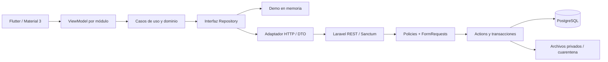
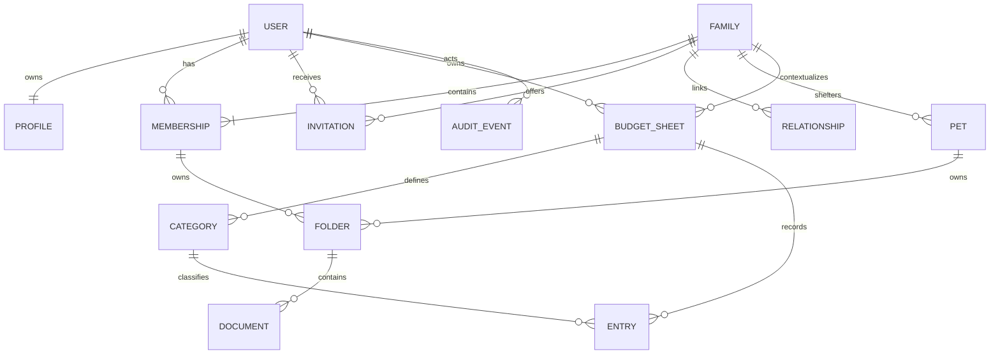

# Arquitectura y contrato de integración

## Decisión ADR-001

Flutter Material 3 y API REST Laravel 13 con PostgreSQL alojado en **Supabase**, elegido por el usuario. Supabase aporta PostgreSQL y Storage privado; Laravel mantiene autenticación Sanctum, policies y transacciones. No se duplican usuarios en Supabase Auth. Monolito modular para tres personas: no microservicios. `app/` conserva el proyecto inicial; `web/` aloja el servidor del stack A. Ver `SUPABASE.md` para separar credenciales y evitar acceso directo a datos.

Flutter: organización por funcionalidad, UI + ViewModel (`ChangeNotifier` inicialmente), dominio independiente, repositorios abstractos y adaptadores de datos. Inyección por constructor en un único punto de composición. El repositorio en memoria solo soporta la demo; el HTTP será la implementación real. La guía oficial recomienda [vistas, modelos de vista y repositorios](https://docs.flutter.dev/app-architecture/guide).

Servidor: FormRequest valida, Policy autoriza, Action/Service ejecuta reglas y transacciones, Eloquent persiste, API Resource filtra campos. Usar repositorio adicional solo si desacopla un origen real; no envolver cada operación Eloquent sin propósito. Strategy para CSV/otros exportadores futuros; un servicio de dominio para presupuesto y otro para parentescos. Nada de Singleton global mutable para la sesión.

## Módulos y contratos congelados

`identity`, `family`, `documents`, `budget`. El contrato `docs/api/CONTRATO.md` es la frontera estable entre agentes. Cada uno implementa UI, datos, API y pruebas de su módulo. Nombres JSON snake_case; Dart camelCase; UUID internos y código público aleatorio separado. Dinero `amount_cents`, nunca `double`. Fechas civiles ISO `YYYY-MM-DD`; instantes UTC ISO-8601.

`core`, punto de composición, `pubspec.yaml`, lockfiles, archivos de rutas agregadores, workflow y migración base tienen propietario de integración: Gerardo. Los otros crean archivos nuevos y solicitan cambios concretos mediante su issue; no reescriben estos archivos simultáneamente. Contratos cambiados mediante PR pequeño antes de consumidores.

## Modelo de datos

Claves: `memberships (family_id,user_id)` única; `is_admin` separado de relaciones; `relationships (family_id,source_id,target_id,kind)` única; invitación pendiente única familia/receptor; `folders` tiene titular humano **o** mascota (XOR); documentos referencian carpeta y autor y no aceptan un `family_id` independiente contradictorio. Categorías y movimientos comparten hoja mediante FK compuesta/validación transaccional. `amount_cents bigint > 0`; límites seguros JS/Dart documentados en contrato. Índices por pertenencia, propietario/año/mes, categoría y expiración.

## Invariantes transaccionales del servidor

- Bloquear la fila del grupo (`SELECT FOR UPDATE`) al remover/degradar admin o salir; volver a contar admins antes de confirmar. Dos salidas simultáneas no pueden dejar cero.
- Aceptación de invitación bloquea invitación y grupo; valida receptor, estado, vigencia e invitador todavía autorizado. Insertar membresía con índice único; repetición devuelve conflicto, nunca duplica.
- Bloquear grupo al modificar ascendencias; búsqueda recursiva detecta ciclos. Hermanos son simétricos; padre/hijo es un enlace dirigido invertible, no dos verdades divergentes.
- Escribir movimientos y validar categoría/hoja/tipo dentro de transacción. Bloquear categoría al eliminar o cambiar tipo si está usada.
- Documentos: reservar metadata -> cargar a cuarentena -> validar MIME/firma/antimalware -> publicar privado -> autorizar cada descarga. Compensación y limpieza si una fase falla.

## Decisiones de seguridad

Ver `SEGURIDAD.md`. El servidor es autoridad incluso si el cliente oculta botones. El administrador de familia no es administrador del sistema. No hay endpoints de listar todos los usuarios o descargar archivos por rutas proporcionadas por cliente.
